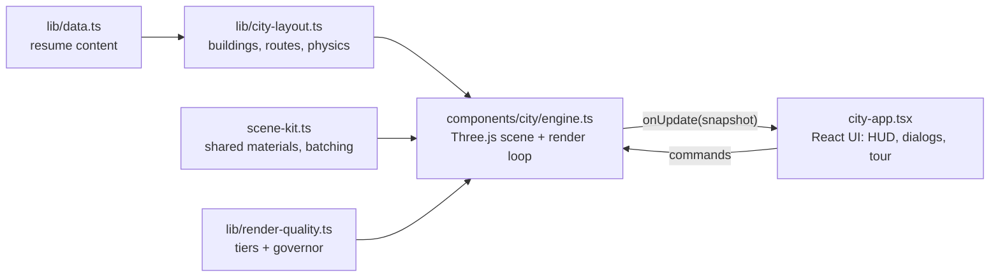

# Buildverse City

A portfolio you drive through. Each of my nine projects is a building in a
procedurally modelled 3D island city, and every floor tells one part of its
story: the problem and outcome, the engineering, and the decisions.

**Live:** [buildverse.anush.tech](https://buildverse.anush.tech) ·
**Short on time?** Press *Watch the 60-second autopilot tour* on the title screen.


## For recruiters

- **60-second autopilot tour:** the camera flies through six stops (about me,
  three flagship projects, skills, contact) and ends on a Hire card with email,
  resume, LinkedIn and GitHub.
- **Directory:** a searchable list of every address, projects first. It also
  works when WebGL is unavailable.
- **Deep links:** every floor has a shareable URL, for example
  [`#city/interview-ace/2`](https://buildverse.anush.tech/#city/interview-ace/2).
  Use the *Copy link* button inside a floor.
- **Plain résumé:** [anush.tech](https://anush.tech/) and the
  [PDF](public/Anush-Gupta-Product-Resume.pdf).

## Engineering highlights

Press <kbd>~</kbd> in the city to open the engine panel. It shows live numbers
from the renderer, so you can check every claim below yourself.

| Feature | What it does | Where |
| --- | --- | --- |
| Static batching | Merges static meshes that share a material into one draw call. Floors keep their own picking identity; moving parts (`userData.batch = "live"`) are batched relative to themselves. A toggle in the engine panel undoes it live. | [`scene-kit.ts`](components/city/scene-kit.ts) |
| Adaptive quality | Three tiers (pixel ratio, shadows, ink pass). In Auto, a governor drops one tier after a 3 s window under 40 fps. It ignores stalls over 250 ms and never steps back up, so the city cannot flicker between tiers. | [`render-quality.ts`](lib/render-quality.ts) |
| Blueprint X-ray | Swaps every mesh to a fresnel-rim additive shader, one colour per material. You see through the city, and each colour is a separate draw call. Press <kbd>X</kbd>. | [`engine.ts`](components/city/engine.ts) |
| Illustrated rendering | A single post-process pass draws ink edges from the colour buffer with five samples, instead of a separate ID/depth/normal pipeline. | [`illustration-pass.ts`](components/city/illustration-pass.ts) |
| Live renderer stats | `renderer.info` is reset by hand once per frame, so counts include shadow and post-processing passes, not only the last pass. | [`perf-hud.tsx`](components/city/perf-hud.tsx) |
| Build-time share image | The Open Graph image draws the real skyline from the building data, one bar per building scaled by floor count. | [`app/og.png/route.tsx`](app/og.png/route.tsx) |

### Measured

Measured in the engine panel, 800 px wide viewport, medium tier:

| | Draw calls per frame |
| --- | --- |
| Static batching off | 3,127 |
| Static batching on | 1,200 (−62%) |

The high tier, which adds the sun's shadow pass, draws 2,324 calls with
batching on. Frame rates depend on the device, so the panel shows yours live
instead of a number in this file.

## Architecture



- **Engine and UI are separate.** [`engine.ts`](components/city/engine.ts) owns
  the Three.js scene and loop and exposes a small command API. React in
  [`city-app.tsx`](components/city/city-app.tsx) renders the HUD and dialogs
  from engine snapshots. While moving, the engine emits a snapshot at most
  every 180 ms, so React does not re-render every frame.
- **Pure logic lives in `lib/`** with no Three.js imports: car physics,
  collision, camera flights, routes, weather, the tour and the quality governor.
  That is what the tests cover.
- **Everything is generated.** No downloaded models or textures. Each of the 15
  addresses has its own massing, built from primitives in
  [`landmarks.ts`](components/city/landmarks.ts) and
  [`architecture.ts`](components/city/architecture.ts).
- **Static export.** Next.js 14 `output: "export"` to GitHub Pages. No backend,
  no API keys, no tracking.

More detail: [`docs/BUILDVERSE_CITY.md`](docs/BUILDVERSE_CITY.md).

## Controls

| Key | Action |
| --- | --- |
| WASD / arrows | Walk (Shift sprints, Space jumps) |
| E | Enter a nearby door |
| F | Get in or out of the car |
| ~ | Engine panel |
| X | Blueprint X-ray |
| Esc | Stop the tour, close dialogs |

Touch devices get an on-screen direction pad.

## Run locally

Requires Node 20.

```bash
npm ci
npm run dev
```

Before pushing:

```bash
npm run lint && npx tsc --noEmit && npm test && npm run build
```

Tests use `node --test` and transpile TypeScript on the fly, so they need no
browser. GitHub Actions runs them and deploys `out/` on pushes to `main`.

## Updating portfolio content

Resume-based content lives in `lib/data.ts`. The downloadable source PDF is in
`public/Anush-Gupta-Product-Resume.pdf`. The first Park+ internship date is
Jan–Feb 2024, corrected by Anush; the original PDF still prints 2023.

## Contact

Anush Gupta · [anushgupta105@gmail.com](mailto:anushgupta105@gmail.com) ·
[buildverse.anush.tech](https://buildverse.anush.tech)
